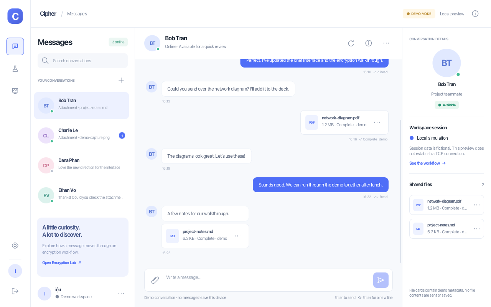

# Cipher Desktop

Java 21 network programming coursework: a modern JavaFX frontend preview alongside
the existing Java Swing/TCP implementation.

**Current UI iteration is mock-first.** Chat, Encryption Lab and Server Monitoring
use replaceable service interfaces and in-memory fixtures. The JavaFX preview makes
no TCP connections and performs no real encryption, file-content transfer or database operations.

## Default application / NetBeans

The repository root is now a Java 21 Maven application. Its default entry point is
`studio.cipher.PreviewLauncher`, which opens the new JavaFX frontend in Demo Mode.
The root build compiles only the JavaFX sources and resources.

In NetBeans, close the previously opened Ant/Swing project, then use **File → Open
Project** to reopen this repository root (`pom.xml`). Set **JDK 21**, select
**Set as Main Project**, and press **F6 / Run Project**. The checked-in
`nbactions.xml` maps Run to `javafx:run`; no main-class chooser is needed.
Close any previously opened `javafx-preview` project as well. There is only one
Maven project, at the repository root; JavaFX sources use the standard
`src/main/java` and `src/test/java` directories. Reopen the root project once if
NetBeans has cached the old project or source ownership.

From the repository root:

```bash
mvn javafx:run
```

The existing Swing/TCP sources remain available through the explicit legacy build
and test scripts. They are not started by the default application.

## Run the JavaFX demo

Requirements: Java 21, Maven 3.9+, Python 3.9+, and a desktop session.
From the repository root:

```bash
cd javafx-preview
python3 scripts/demo.py run
```

An independent simulated monitoring window:

```bash
python3 scripts/demo.py run --monitor
```

Build once, then launch without Maven or an IDE:

```bash
python3 scripts/demo.py build
./target/demo/run-demo.sh
# Windows: target\demo\run-demo.cmd
```

The portable bundle requires Java 21. Build it on the target operating system
because JavaFX native libraries are platform-specific.

## Preview



[Encryption Lab](javafx-preview/docs/screenshots/encryption-lab.png) ·
[Server Monitoring](javafx-preview/docs/screenshots/server-monitoring.png)

## Project layout

- `src/main/java/`: JavaFX UI, service interfaces and in-memory mocks.
- `src/main/resources/`: FXML layouts and JavaFX CSS.
- `src/test/java/`: JavaFX verification driver.
- `javafx-preview/`: demo packaging scripts, documentation and screenshots.
- `src/client/`, `src/common/`, `src/server/`: preserved legacy Swing/AES demo.
- `src/chat/`: existing multi-user Swing/TCP Server and Client implementation.
- `test/`, `scripts/`: existing application build and regression/integration tests.
- `docs/`: protocol, coursework requirements, architecture and existing Server documentation.

The existing backend is included for reference and future integration. The JavaFX
module does not depend on it. Backend behavior has not been redesigned in this iteration.

## Verification

```bash
# JavaFX: real toolkit, packaged FXML/CSS, interactions, metrics, screenshots
cd javafx-preview
python3 scripts/demo.py verify
```

From the repository root, test the existing Swing/TCP implementation separately:

```bash
python3 scripts/test.py
```

This command starts local test Servers and uses temporary data and ports.
English Java type names use PascalCase; see [naming cleanup](docs/CLASS_NAMING.md).

## Documentation

- [JavaFX launch guide](javafx-preview/README.md)
- [UI architecture](javafx-preview/ARCHITECTURE.md)
- [Components and CSS design system](javafx-preview/COMPONENTS.md)
- [Actual JavaFX verification results](javafx-preview/VERIFICATION.md)
- [Existing Swing/TCP guide](docs/SWING_README.md)
- [Existing protocol](docs/PROTOCOL.md)
- [Existing database design](docs/DATABASE.md)

No real authentication or encryption is implied by the mock demo. The existing
Server decrypts coursework messages for letter counting and is not E2EE.
