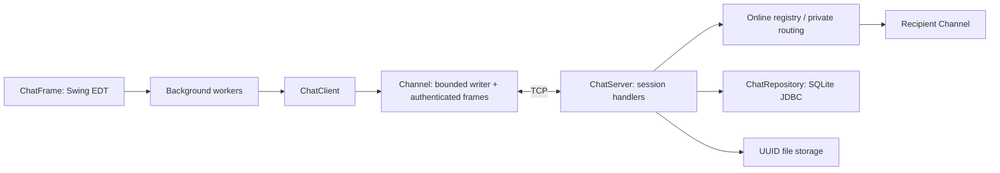

# Kiến trúc ứng dụng AES Chat v2

## Thành phần được giữ và mở rộng

`DoAn_ChatAES` vẫn là project Java 21 / Swing / NetBeans. Không dùng web service.
`common.AESUtil` (CBC), `common.RSAUtil`, `common.LetterFrequency` và test cũ được giữ.
`client.ClientMain` mở `chat.client.ChatFrame`; `--legacy` mở `client.ClientFrame` cũ.
`server.MockServer` vẫn là Server v1 riêng, không phải Server demo multi-user.

## Phiên và đồng thời

Một socket = một UUID phiên và username. Tên có 1–24 chữ Unicode, số, `_`, `-`;
phân biệt hoa thường. Server từ chối tên đang online. Tên có thể dùng lại sau ngắt,
không có mật khẩu. Khóa AES thuộc phiên, không dùng chung giữa Alice/Bob/Charlie.
Server gán danh tính người gửi từ phiên; không tin trường `from` từ Client.

Virtual thread nhận cho mỗi phiên; một writer riêng với queue tối đa 32 frame.
Writer là nơi duy nhất ghi socket sau handshake. Queue đầy quá 3 giây làm đóng
kết nối chậm để tránh giữ RAM vô hạn. File đọc/ghi bằng buffer 64 KiB, từng chunk
là frame độc lập. Upload được lưu đủ và kiểm SHA-256 trước khi worker khác gửi
sang người nhận. Mỗi phiên có tối đa 2 upload, 4 download; tối đa 100 socket.
Phiên idle quá 120 giây bị đóng; Client gửi heartbeat mỗi 20 giây.

SQLite dùng một connection được serialize, WAL và busy timeout 5 giây. Transaction
ngắn gộp message + thống kê, user + session; không giữ khóa DB khi ghi socket.
DB lỗi trả ERROR, không giả báo lưu thành công. Không tự chuyển sang lưu RAM.

## Swing

Mọi network I/O, đổi khóa, truyền file và copy file nằm trên background executor.
Callback đẩy về EDT bằng `invokeLater`. Ngắt đóng socket trực tiếp, không chờ lock
của writer. Đổi khóa có barrier ngoài EDT để frame sau chỉ dùng khóa mới sau ACK;
file đang gửi tạm dừng ở ranh giới chunk. Thế hệ kết nối giúp bỏ callback phiên cũ.
Lab cũ cũng đã chuyển gửi text/trao đổi khóa sang SwingWorker và ngắt không chờ upload.

Server console là view nhẹ: dòng RUNNING, online count, JOIN/OFFLINE UUID, lỗi;
gõ `status`, `sessions`, `quit` để xem trạng thái, phiên hiện tại hoặc tắt an toàn.
Không log AES key/RSA private key. Nội dung v2 không in ra log Server.

## Giới hạn thiết kế

Đây là mã hóa Client–Server, **không E2EE**: Server phải giải mã để đếm chữ cái.
Không có xác thực danh tính người dùng hay chứng chỉ Server. Một người có thể nhận
username cũ và xem lịch sử của tên đó; chỉ dùng trong mạng demo tin cậy.
Không có redelivery offline, resume upload, quota tổng dung lượng hay dọn file tự động.
Chat echo cho người gửi nghĩa là Server đã lưu và đưa vào queue người nhận, chưa
phải xác nhận người nhận đã đọc. File có ACK sau khi SHA-256 khớp.
