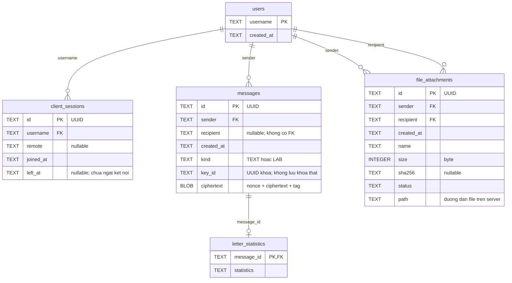

# SQLite và dữ liệu lịch sử

Server dùng Xerial SQLite JDBC 3.46.1.0 (JDBC trực tiếp), không cần cài DB Server.
Dependency được pin SHA-256 trong `DoAn_ChatAES/scripts/build.py` và đóng kèm `dist/lib`.
Một process Server sở hữu một thư mục dữ liệu. Không mở hai Server trên cùng thư mục.

Mặc định tính từ working directory: `server-data/chat.db`, `chat.db-wal`, `chat.db-shm`,
`server-data/files/<UUID>.bin`. Có thể đổi bằng `--data DIR`.

| Bảng | Dữ liệu |
|---|---|
| users | username PK, created_at |
| client_sessions | UUID PK, username FK, remote address, joined_at, left_at |
| messages | UUID PK, sender FK, recipient nullable, UTC, kind TEXT/LAB, key_id, ciphertext BLOB |
| letter_statistics | message_id PK/FK, chuỗi thống kê chữ cái |
| file_attachments | UUID PK, sender/recipient FK, UTC, tên hiển thị, size, SHA-256, status, path |

## ERD — cấu trúc database hiện tại

Sơ đồ dưới đây bám theo câu lệnh `CREATE TABLE` trong
[`ChatRepository.java`](../src/chat/server/ChatRepository.java), thuộc backend
Swing/TCP hiện có. JavaFX Demo hiện chỉ dùng dữ liệu trong RAM, chưa kết nối DB này.
Mở file trên GitHub để xem sơ đồ Mermaid được render.



Cách đọc và các điểm cần phân biệt:

- `PK`: khóa chính; `FK`: khóa ngoại. `||` là đúng một, `o{` là từ không đến
  nhiều, `o|` là không hoặc một.
- Một user có thể có nhiều phiên kết nối, gửi nhiều tin nhắn và gửi/nhận nhiều file.
- Mỗi dòng thống kê thuộc đúng một tin nhắn. Schema cho phép tin nhắn chưa có
  thống kê; hàm `message()` hiện ghi cả hai trong cùng transaction.
- `messages.recipient` hiện là chuỗi username có thể null, **chưa khai báo FK**,
  nên sơ đồ không vẽ quan hệ khóa ngoại cho trường này. Ngược lại,
  `file_attachments.recipient` có FK đến `users.username`.
- `file_attachments` chưa có `message_id`: file và tin nhắn là hai loại bản ghi
  riêng, không có quan hệ FK trực tiếp dù UI có thể hiển thị file như tin đính kèm.
- `key_id` không trỏ đến bảng khóa nào. File thật được lưu ngoài database;
  bảng `file_attachments` chỉ giữ metadata và đường dẫn.

Không tạo conversation table: v1 extension chỉ có chat 1–1, cặp sender/recipient
đã định danh cuộc trò chuyện. Query lịch sử luôn gồm username của chính phiên.
Prepared statements cho mọi tham số người dùng; transaction gộp message + thống kê
và user + session. Connection synchronized, WAL, foreign_keys, busy_timeout=5000.
Lỗi insert không trả RESULT thành công. Query và ghi serialize ngắn, không có I/O
mạng trong critical section của repository.

## Bản mã và khóa

`messages.ciphertext` = nonce(12) + AES-GCM ciphertext + tag(16), mã hóa bằng khóa
phiên gửi tại thời điểm lưu, AAD `history/<message UUID>`. `key_id` chỉ là UUID,
không phải khóa. Không lưu bản rõ message, khóa AES, khóa RSA private, password
hay chuỗi khóa Lab trong DB/log v2. Thống kê chữ cái để rõ theo yêu cầu bài tập;
metadata/tên người dùng/tên file/thời gian cũng để rõ.

Server có cache tối đa 1024 khóa đã dùng trong RAM để giải mã lịch sử trong cùng
lần chạy, kể cả sau khi người gửi ngắt hoặc đổi khóa. Khi cache đẩy khóa cũ ra hoặc
Server restart, nội dung tương ứng hiện `[Bản mã lịch sử: khóa phiên không còn trong RAM]`.
Metadata, thống kê và file vẫn xem/tải được. Không thể khôi phục nội dung chat cũ
bằng cách gõ lại khóa ở Client vì không lưu khóa vào repository.
Đây là giới hạn được hiển thị, không trả một chuỗi bản mã như thể là bản rõ.

File giữ dưới dạng bản rõ trên ổ đĩa Server để tải lại sau restart; không đưa file
lớn vào BLOB. File chỉ mã hóa trên đường truyền. Người có quyền đọc thư mục Server
có thể đọc file; cần dùng tài khoản hệ điều hành/thư mục riêng và quản lý sao lưu.
Tên Client được làm sạch, nhưng path thực tế luôn là UUID do Server sinh.
Không nhận đường dẫn tùy ý từ Client. FILE_GET kiểm sender/recipient và lượt tải ACK.
Username không có mật khẩu nên quyền truy xuất này chỉ có ý nghĩa trong mô hình
mạng demo tin cậy: người khác có thể nhận tên cũ sau khi chủ tên offline.

## Vòng đời file / phiên

Trạng thái: UPLOADING → STORED → DELIVERED (sau ACK hash).
Nhánh lỗi: CANCELLED, FAILED, INTERRUPTED, RECIPIENT_OFFLINE.
Recipient offline sau upload: giữ file và báo sender; không tự gửi lại.
Dùng lịch sử để tải lại khi kết nối. Hash mismatch xóa file .part, không công bố file.
Crash: khi start Server đánh dấu phiên chưa đóng là offline, upload chưa xong là
INTERRUPTED và xóa `.part`. File hoàn chỉnh vẫn giữ. Không có chính sách retention
hay tổng disk quota trong v2 này; xóa dữ liệu demo khi không cần nữa.

## Kiểm tra thủ công (nếu có sqlite3 CLI)

```bash
sqlite3 server-data/chat.db '.tables'
sqlite3 server-data/chat.db 'SELECT sender,recipient,kind,created_at,length(ciphertext) FROM messages;'
sqlite3 server-data/chat.db 'SELECT * FROM letter_statistics;'
sqlite3 server-data/chat.db 'SELECT name,size,sha256,status FROM file_attachments;'
sqlite3 server-data/chat.db 'SELECT username,joined_at,left_at FROM client_sessions;'
```

Để backup nhất quán, tắt Server bằng `quit`/Ctrl+C rồi copy cả thư mục --data.
Không copy riêng file DB trong lúc WAL đang hoạt động.
Nguồn dependency: [Xerial SQLite JDBC](https://github.com/xerial/sqlite-jdbc).
