> **Báo cáo Client v1 được giữ để đối chiếu.** Bản nâng cấp có Chat + Encryption Lab, AES-GCM và SQLite; xem [ARCHITECTURE.md](ARCHITECTURE.md) và [IMPLEMENTATION_STATUS.md](IMPLEMENTATION_STATUS.md).

# CHƯƠNG 2 — PHÂN TÍCH VÀ XÂY DỰNG CLIENT

> Đề tài 8: Chương trình Chat, gửi file (audio, video, hình ảnh) giữa Client – Server bằng Java,
> giao thức TCP, mã hóa/giải mã văn bản bằng AES.
> Phần phụ trách: **Client + Giao diện + AES**. Mã nguồn: `DoAn_ChatAES/src/client/` và `src/common/`.
> Giao thức thống nhất với Server: [DoAn_PROTOCOL.md](DoAn_PROTOCOL.md).

## Mục lục

| Mục | Nội dung |
|---|---|
| [2.1](#21-thiết-kế-giao-diện) | Thiết kế giao diện |
| [2.2](#22-kiến-trúc-client) | Kiến trúc Client |
| [2.3](#23-quy-trình-mã-hóa-aes) | Quy trình mã hóa AES và trao đổi khóa |
| [2.4](#24-quy-trình-gửinhận-dữ-liệu) | Quy trình gửi/nhận dữ liệu qua TCP |
| [2.5](#25-hình-ảnh-giao-diện-và-kết-quả-chạy-chương-trình) | Hình ảnh giao diện và kết quả chạy |
| [2.6](#26-kiểm-thử) | Kiểm thử |
| [Phụ lục](#phụ-lục--câu-hỏi-vấn-đáp-dự-kiến) | Câu hỏi vấn đáp dự kiến |

---

## 2.1 Thiết kế giao diện

### 2.1.1 Yêu cầu từ đề

Phía Client của đề tài 8 phải: (1) cho phép **nhập văn bản và khóa**, mã hóa văn bản bằng AES trước
khi gửi; (2) **trao đổi khóa** với Server; (3) **nhận kết quả** Server trả về (số lần xuất hiện của
từng chữ cái); (4) **gửi file** hình ảnh, audio, video. Ngoài ra, theo tinh thần chung của các đề
Client–Server trong môn: nhập địa chỉ và cổng, kết nối thất bại thì báo và cho nhập lại.

### 2.1.2 Bố cục

Giao diện là một `JFrame` duy nhất, chia **5 vùng đánh số theo đúng thứ tự người dùng thao tác**.
Cột trái là chuỗi hành động (kết nối → khóa → văn bản → file), cột phải là kết quả và nhật ký để
người dùng luôn thấy phản hồi của Server mà không phải chuyển màn hình.

```
┌─ 1. Kết nối Server (TCP) ───────────────────────────────┐ ┌─ 5. Kết quả Server trả về ─────┐
│ Địa chỉ [localhost ] Cổng [5555] [Kết nối] [Ngắt] ● Trạng thái │ │ Bản rõ Server giải mã: …       │
├─ 2. Khóa AES và trao đổi khóa (RSA-2048 OAEP) ──────────┤ │ ┌──────────┬─────────┐         │
│ Khóa (chuỗi bất kỳ) [                 ] [Trao đổi khóa] │ │ │ Chữ cái  │ Số lần  │         │
│ RSA public key Server (fingerprint): …                  │ │ │ a        │ 2       │         │
│ Khóa AES-256 = SHA-256("…") = …                         │ │ │ …        │ …       │         │
├─ 3. Văn bản → mã hóa AES → gửi Server ──────────────────┤ │ └──────────┴─────────┘         │
│ ┌ Bản rõ ─────────────────────────────────────────────┐ │ │ ┌ Nhật ký ─────────────────┐   │
│ │                                                     │ │ │ │ [hh:mm:ss] → KEY_EXCHANGE│   │
│ └─────────────────────────────────────────────────────┘ │ │ │ [hh:mm:ss] ← KEY_OK      │   │
│                      [Xem bản mã] [Mã hóa và gửi]       │ │ │ [hh:mm:ss] → TEXT …      │   │
│ ┌ IV + bản mã (Base64) đã/sẽ gửi ─────────────────────┐ │ │ │ [hh:mm:ss] ← RESULT …    │   │
│ └─────────────────────────────────────────────────────┘ │ │ │                          │   │
├─ 4. Gửi file (hình ảnh / audio / video) ────────────────┤ │ │                          │   │
│ [Chọn file…] tên, kích thước, kích thước bản mã  [ảnh]  │ │ │                          │   │
│ [████████████░░░░░░░░ 62 %          ]            [thu]  │ │ │                          │   │
│                              [Mã hóa và gửi file] [nhỏ] │ │ └──────────────────────────┘   │
└─────────────────────────────────────────────────────────┘ └────────────────────────────────┘
```

Layout dùng `GridBagLayout` lồng nhau: khung ngoài 2 cột (trái `weightx = 1`, phải `0.7`), mỗi vùng
là một `JPanel` có `TitledBorder`. Vùng 3 và 5 có `weighty > 0` nên khi kéo to cửa sổ, ô văn bản và
nhật ký nở ra, các vùng còn lại giữ chiều cao.

### 2.1.3 Bảng thành phần

| Vùng | Component | Tên biến | Chức năng |
|---|---|---|---|
| 1 | `JTextField` | `txtHost`, `txtPort` | Địa chỉ/cổng Server, mặc định `localhost:5555` |
| 1 | `JButton` | `btnKetNoi`, `btnNgat` | Mở/đóng kết nối TCP. Kết nối chạy trong `SwingWorker` |
| 1 | `JLabel` | `lblTrangThai` | ● đỏ "Chưa kết nối" / ● xanh "Đã kết nối host:port" |
| 2 | `JTextField` | `txtKhoa` | Khóa người dùng nhập (chuỗi bất kỳ) |
| 2 | `JButton` | `btnTraoDoiKhoa` | Dẫn xuất khóa AES, bọc RSA, gửi `KEY_EXCHANGE` |
| 2 | `JLabel` | `lblRSA` | Fingerprint SHA-256 của public key Server nhận trong `HELLO` |
| 2 | `JLabel` | `lblKhoaDanXuat` | Hex khóa AES-256 đã dẫn xuất (tooltip hiện đủ 64 hex) |
| 3 | `JTextArea` | `txtVanBan` | Bản rõ cần gửi |
| 3 | `JButton` | `btnXemBanMa` | Mã hóa **không gửi**, hiện IV + bản mã Base64 để quan sát |
| 3 | `JButton` | `btnGuiVanBan` | Mã hóa và gửi `TEXT` |
| 3 | `JTextArea` | `txtBanMa` | IV (hex) + bản mã (Base64) + kích thước — chỉ đọc |
| 4 | `JButton` | `btnChonFile` | `JFileChooser` với 3 bộ lọc Hình ảnh / Audio / Video |
| 4 | `JLabel` | `lblFile`, `lblXemTruoc` | Tên, kích thước gốc, kích thước bản mã; thumbnail nếu là ảnh |
| 4 | `JProgressBar` | `prgTienDo` | % và số byte đã mã hóa/gửi |
| 4 | `JButton` | `btnGuiFile` | Gửi `FILE` trong `SwingWorker`, cập nhật progress qua `publish` |
| 5 | `JTable` | `tblDemChuCai` | Bảng Chữ cái – Số lần, theo thứ tự Server sắp (giảm dần) |
| 5 | `JLabel` | `lblTong` | Bản rõ Server đã giải mã, số chữ cái khác nhau, tổng số lần |
| 5 | `JTextArea` | `txtNhatKy` | Nhật ký có timestamp: `→` gửi, `←` nhận, lỗi |

### 2.1.4 Máy trạng thái của nút

Nút của bước sau bị vô hiệu cho tới khi bước trước xong, nên **không thể gửi dữ liệu khi chưa có
khóa** và không thể trao đổi khóa khi chưa kết nối. Toàn bộ logic nằm trong một hàm
`capNhatTrangThai()` được gọi sau mỗi sự kiện:

| Trạng thái | Kết nối | Ngắt | Trao đổi khóa | Xem bản mã / Gửi | Gửi file |
|---|---|---|---|---|---|
| Chưa kết nối | ✅ | ❌ | ❌ | ❌ | ❌ |
| Đã kết nối, chưa có khóa | ❌ | ✅ | ✅ | ❌ | ❌ |
| Đã có khóa | ❌ | ✅ | ✅ (đổi khóa) | ✅ | ✅ nếu đã chọn file |
| Đang gửi file | ❌ | ✅ | ✅ | ❌ | ❌ |

Kết nối thất bại (Server chưa chạy, sai cổng, timeout 5 giây) → `JOptionPane` báo lỗi và yêu cầu
nhập lại; ô địa chỉ/cổng mở khóa trở lại.

---

## 2.2 Kiến trúc Client

### 2.2.1 Phân lớp

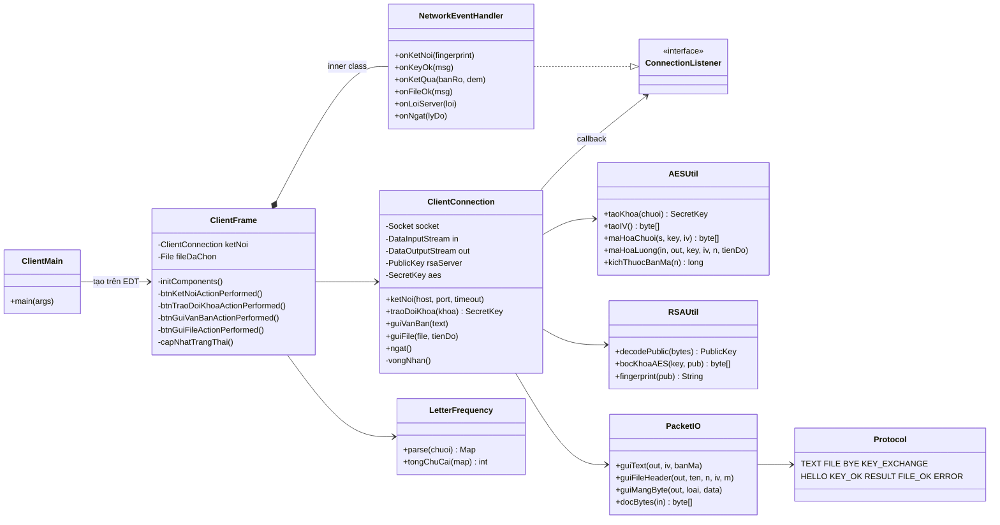

| Package | Lớp | Vai trò |
|---|---|---|
| `client` | `ClientMain` | Điểm vào: đặt Look & Feel hệ thống, tạo `ClientFrame` trên EDT |
| `client` | `ClientFrame` | Toàn bộ Swing. Không chạm socket, không chạm byte |
| `client` | `ClientConnection` | Toàn bộ mạng: socket, handshake, gửi, thread nhận. Không biết Swing |
| `common` | `Protocol`, `PacketIO` | Hằng số loại gói và cách ghi/đọc payload — dùng chung với Server |
| `common` | `AESUtil`, `RSAUtil` | Mật mã — dùng chung với Server |
| `common` | `LetterFrequency` | Định dạng kết quả đếm — Server tạo, Client parse |

Tách `ClientFrame` và `ClientConnection` theo hai hướng phụ thuộc: GUI gọi xuống mạng bằng phương thức
thường; mạng gọi lên GUI qua interface `ConnectionListener`. Nhờ vậy `ClientConnection` kiểm thử được **không cần
giao diện** (kịch bản E2E ở mục 2.6 chính là một `ConnectionListener` in ra console), và package `common` đưa
thẳng cho bạn làm Server dùng lại.

### 2.2.2 Mô hình luồng

Swing chỉ an toàn khi mọi thao tác lên component diễn ra trên **Event Dispatch Thread (EDT)**; đồng
thời EDT không được bị chặn bởi I/O, nếu không giao diện đứng hình. Client dùng 3 loại thread:

```mermaid
flowchart LR
    subgraph EDT["EDT (Swing)"]
        A[Sự kiện nút] --> B[capNhatTrangThai / ghiNhatKy / đổ JTable]
    end
    subgraph W["SwingWorker (thread pool)"]
        C[ketNoi: connect + đọc HELLO]
        D[guiFile: đọc file → AES → socket<br/>publish(tiến độ)]
    end
    subgraph R["Thread 'client-nhan' (daemon)"]
        E[vòng lặp readByte → switch loại gói]
    end
    A -- execute() --> C
    A -- execute() --> D
    C -- done() --> B
    D -- process()/done() --> B
    E -- ConnectionListener.onXxx --> F[SwingUtilities.invokeLater] --> B
```

| Việc | Thread | Lý do |
|---|---|---|
| Kết nối TCP, đọc `HELLO` | `SwingWorker` | `connect()` có thể chờ tới timeout 5 s — không để trên EDT |
| Trao đổi khóa, gửi `TEXT` | EDT | Chỉ vài KB vào buffer socket, tức thời; gọi thẳng cho đơn giản |
| Gửi `FILE` | `SwingWorker` | File hàng trăm MB, mất nhiều giây; `publish()` đẩy tiến độ về `process()` trên EDT |
| Nhận mọi gói từ Server | thread riêng `client-nhan` | `readByte()` chặn vô hạn; là daemon nên không giữ JVM sống khi đóng cửa sổ |

Mọi callback từ `client-nhan` đi qua lớp trong `NetworkEventHandler`, mỗi phương thức bọc `SwingUtilities.invokeLater`
trước khi chạm component. Hai thread (gửi file và gửi văn bản / trao đổi khóa) có thể cùng ghi vào
một socket, nên `ClientConnection` khóa `synchronized (out)` quanh **trọn một gói**: header `FILE` và thân
file không bao giờ bị gói `TEXT` chen vào giữa.

### 2.2.3 Vòng đời một phiên

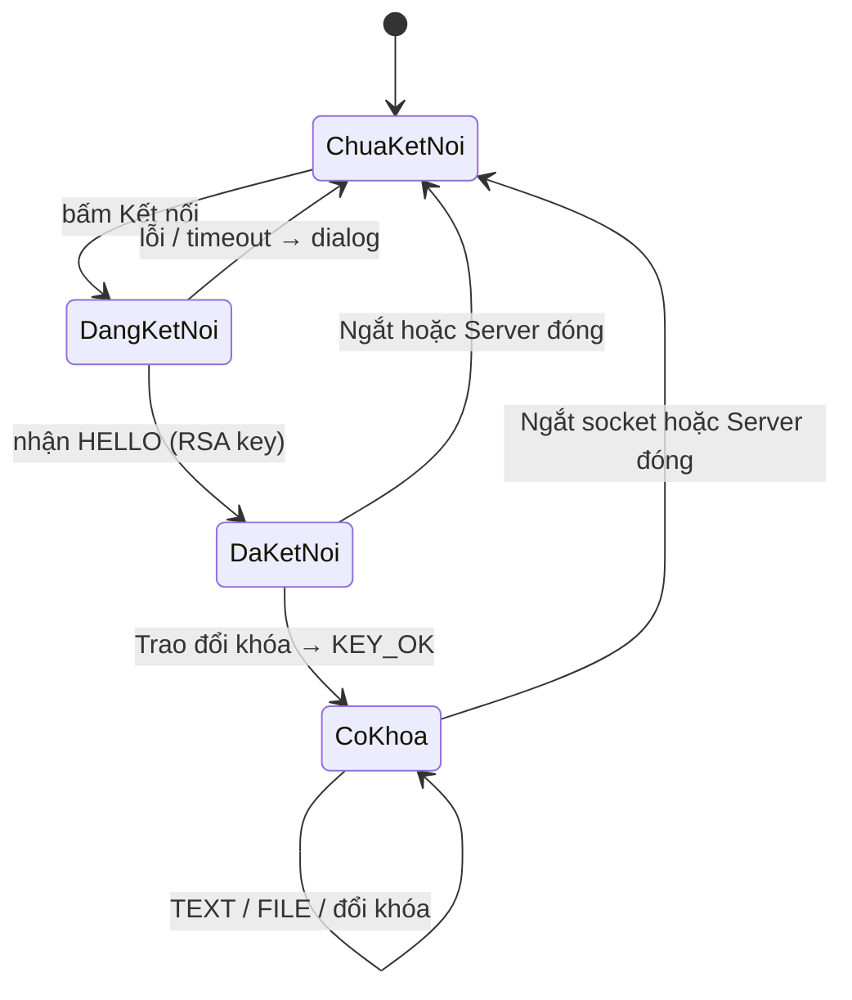

---

## 2.3 Quy trình mã hóa AES

### 2.3.1 Tham số

| | Giá trị | Ghi chú |
|---|---|---|
| Thuật toán | AES (Rijndael), khối 128 bit | Chuẩn FIPS 197, thay thế DES từ 2001 |
| Độ dài khóa | **256 bit** | `SHA-256` cho ra đúng 32 byte |
| Chế độ | **CBC** (Cipher Block Chaining) | Mỗi khối XOR với bản mã khối trước rồi mới mã hóa |
| Đệm | **PKCS5Padding** | Bản rõ không chia hết 16 byte → thêm k byte giá trị k (1 ≤ k ≤ 16) |
| IV | 16 byte, `SecureRandom`, mới mỗi gói | Gửi kèm trước bản mã |
| Java | `Cipher.getInstance("AES/CBC/PKCS5Padding")` | Có sẵn trong JDK, không thư viện ngoài |

### 2.3.2 Dẫn xuất khóa từ chuỗi người dùng

AES chỉ nhận khóa **đúng 16, 24 hoặc 32 byte**; người dùng lại muốn gõ chuỗi bất kỳ ("khoa bi mat
2026"). Client băm chuỗi bằng SHA-256 để có 32 byte cố định:

```java
// common/AESUtil.java
public static SecretKey taoKhoa(String khoaNguoiDung) {
    byte[] digest = MessageDigest.getInstance("SHA-256")
            .digest(khoaNguoiDung.getBytes(StandardCharsets.UTF_8));
    return new SecretKeySpec(digest, 0, 32, "AES");
}
```

Tính chất cần: **xác định** (cùng chuỗi → cùng khóa, ở mọi máy) và **một chiều** (từ khóa không suy ra
chuỗi). Giao diện hiện hex của khóa dẫn xuất ngay dưới ô nhập để đối chiếu với log Server
(hình 2.3 và log ở 2.5).

### 2.3.3 Vì sao CBC cần IV và vì sao IV đổi mỗi lần

Với CBC, khối đầu tiên được XOR với IV trước khi mã hóa: `C₁ = E(K, P₁ ⊕ IV)`, `Cᵢ = E(K, Pᵢ ⊕ Cᵢ₋₁)`.
Nếu IV cố định, hai tin nhắn cùng nội dung sẽ cho **cùng bản mã** — kẻ nghe lén tuy không đọc được
nhưng biết "hai lần này gửi cùng một câu", và với ECB (không IV) còn nhìn ra cấu trúc dữ liệu. Client
sinh IV ngẫu nhiên **cho từng gói** và gửi IV kèm bản mã; IV không cần bí mật, chỉ cần không lặp.
Hình 2.5b chứng minh: gửi lại đúng câu "Xin chao AES 123", bản mã Base64 khác hoàn toàn, Server
vẫn giải mã ra cùng bản rõ.

### 2.3.4 Trao đổi khóa bằng RSA

AES là mã **đối xứng**: Server phải có cùng khóa. Gửi 32 byte khóa thẳng qua TCP thì ai bắt gói cũng
giải mã được toàn bộ phiên. Client vì thế dùng mô hình **hybrid** giống TLS:

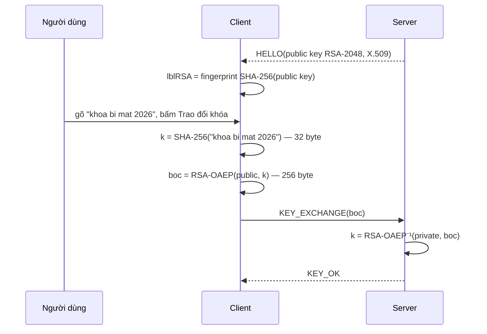

```java
// common/RSAUtil.java
Cipher c = Cipher.getInstance("RSA/ECB/OAEPWithSHA-256AndMGF1Padding");
c.init(Cipher.ENCRYPT_MODE, publicKeyServer);
byte[] boc = c.doFinal(aesKey.getEncoded());   // 32 byte → 256 byte
```

- Public key đi qua mạng dạng thô là chấp nhận được: nó vốn công khai. Chỉ private key (không bao
  giờ rời Server) mới mở được khóa AES.
- OAEP thay PKCS#1 v1.5 vì padding cũ đã bị tấn công lựa chọn bản mã (Bleichenbacher 1998).
- Fingerprint hiện trên GUI để người dùng có thể đối chiếu với console Server — cách phát hiện
  man-in-the-middle thủ công (giống xác nhận host key của SSH).
- Đổi khóa giữa phiên = gửi lại `KEY_EXCHANGE`; Server thay khóa của phiên đó.

### 2.3.5 Mã hóa văn bản

```java
// client/ClientConnection.java
byte[] iv    = AESUtil.taoIV();                          // 16 byte ngẫu nhiên
byte[] banMa = AESUtil.maHoaChuoi(vanBan, aes, iv);      // UTF-8 → AES/CBC/PKCS5
synchronized (out) { PacketIO.guiText(out, iv, banMa); }   // TEXT | len iv | iv | len ct | ct
```

Ví dụ thực tế (log ở 2.5): `"Xin chao AES 123"` là 16 byte UTF-8 → bản mã **32 byte** (16 byte dữ
liệu + 1 khối đệm nguyên 16 byte, vì PKCS5 luôn đệm). Câu tiếng Việt
`"Đại Anh Dũng — Lập trình mạng"` là 40 byte UTF-8 → **48 byte**.

### 2.3.6 Mã hóa file theo luồng

File không thể đọc hết vào RAM rồi `doFinal` (video hàng trăm MB). Client dùng `Cipher.update()` theo
chunk 64 KB và ghi thẳng vào socket:

```java
// common/AESUtil.java — maHoaLuong
Cipher c = Cipher.getInstance("AES/CBC/PKCS5Padding");
c.init(Cipher.ENCRYPT_MODE, key, new IvParameterSpec(iv));
byte[] buf = new byte[65536];
while (conLai > 0) {
    int n = in.read(buf, 0, (int) Math.min(buf.length, conLai));
    out.write(c.update(buf, 0, n));        // mã hóa từng chunk, ghi ngay
    conLai -= n;  tienDo.accept(daXuLy += n);
}
out.write(c.doFinal());                    // khối đệm cuối
```

Vấn đề: Server phải biết **trước** bản mã dài bao nhiêu để đọc đúng rồi dừng (TCP không có dấu hết
gói). PKCS5 cho công thức chính xác:

```
kichThuocBanMa = (kichThuocGoc / 16 + 1) * 16
```

| Kích thước gốc | Bản mã | | Kích thước gốc | Bản mã |
|---|---|---|---|---|
| 0 | 16 | | `anh_mau.png` 42 900 | 42 912 |
| 15 | 16 | | `video_mau.mp4` 119 434 | 119 440 |
| 16 | 32 | | `audio_mau.wav` 264 644 | 264 656 |
| 17 | 32 | | file 60 000 000 | 60 000 016 |

Client ghi con số này vào header `FILE`; giao diện cũng hiện "42900 byte → bản mã 42912 byte" ngay khi
chọn file (hình 2.7). Tính đúng cho mọi biên được kiểm chứng ở `CommonSelfTest` (mục 2.6).

---

## 2.4 Quy trình gửi/nhận dữ liệu

### 2.4.1 Đóng gói trên TCP

TCP là **luồng byte** liên tục: một `write()` 1 000 byte có thể đến bên kia thành hai `read()` 600 +
400, hoặc hai gói liên tiếp dính vào một `read()`. Vì vậy Client và Server thống nhất mọi gói đều
tự khai độ dài:

```
┌──────┬────────────────────────────────────────┐
│ 1 B  │ payload                                │
│ loại │  chuỗi   : writeUTF  (2 B độ dài + UTF-8)│
│      │  mảng    : writeInt(len) + bytes         │
└──────┴────────────────────────────────────────┘
```

Gói `TEXT` cụ thể trên dây:

```
01 | 00 00 00 10 | <16 byte IV> | 00 00 00 20 | <32 byte bản mã>
```

`DataInputStream.readFully()` chờ đủ đúng số byte đã khai, nên bên nhận không bao giờ đọc thiếu hay
lố sang gói sau. Hằng số loại gói và các hàm ghi/đọc nằm trong `common.Protocol` / `common.PacketIO` —
Client và Server dùng **cùng file**, nên không thể lệch định dạng.

### 2.4.2 Trình tự văn bản

```mermaid
sequenceDiagram
    participant G as ClientFrame (EDT)
    participant K as ClientConnection
    participant R as thread client-nhan
    participant S as Server
    G->>K: guiVanBan("Xin chao AES 123")
    K->>K: iv = taoIV(); ct = AES(k, iv, utf8)
    K->>S: TEXT(iv, ct)   [synchronized(out)]
    G->>G: txtBanMa = IV hex + Base64(ct); ghiNhatKy("→ TEXT …")
    S-->>R: RESULT("Xin chao AES 123", "a=2;c=1;e=1;…")
    R->>G: invokeLater(onKetQua)
    G->>G: parse → JTable; lblTong; ghiNhatKy("← RESULT …")
```

Client gửi không chờ trả lời (bất đồng bộ): có thể bấm gửi 5 lần liên tiếp, 5 `RESULT` về theo đúng
thứ tự vì TCP bảo toàn trật tự và Server xử lý tuần tự trong một phiên (kiểm chứng ở E2E bước 8).

### 2.4.3 Trình tự file

```mermaid
sequenceDiagram
    participant G as ClientFrame (EDT)
    participant W as SwingWorker
    participant K as ClientConnection
    participant S as Server
    participant R as thread client-nhan
    G->>W: execute()  (btnGuiFile disabled, dangGuiFile = true)
    W->>K: guiFile(file, publish)
    K->>K: n = file.length(); iv = taoIV(); m = (n/16+1)*16
    K->>S: FILE(tên, n, iv, m)            [bắt đầu synchronized(out)]
    loop mỗi 64 KB
        K->>S: cipher.update(chunk)
        K-->>W: tienDo(daXuLy)
        W-->>G: process(): prgTienDo = %
    end
    K->>S: cipher.doFinal(); flush          [hết synchronized(out)]
    W-->>G: done(): "100% — đã gửi, chờ Server xác nhận…"
    S-->>R: FILE_OK("Đã lưu … SHA-256: …")
    R->>G: invokeLater(onFileOk) → nhật ký + "Server đã nhận và lưu"
```

Ba điểm đáng chú ý:

1. **Header đi trước, thân đi sau trong cùng một khối `synchronized`** — nếu người dùng bấm "Mã hóa và
   gửi" văn bản trong lúc file đang truyền, gói `TEXT` phải xếp hàng chờ file xong, không được chen
   vào giữa thân file (sẽ làm Server giải mã sai). Giao diện cũng vô hiệu nút gửi văn bản trong lúc
   gửi file để tránh nhầm lẫn.
2. **Progress bar** nhận số byte bản rõ đã đọc, không phải byte đã tới Server — trên localhost 60 MB
   đi hết trong dưới 0,1 s nên thanh nhảy thẳng 100 %; qua mạng LAN thật mới thấy chạy dần.
   Chuỗi "đã gửi, chờ Server xác nhận" phân biệt rõ hai mốc: ghi xong vào socket vs Server đã lưu.
3. **Đối chiếu toàn vẹn**: Server tính SHA-256 của bản rõ khi ghi file và trả trong `FILE_OK`; người
   dùng so với `shasum -a 256` của file gốc. Mục 2.5 cho thấy hai giá trị trùng nhau với cả ba loại
   file.

### 2.4.4 Nhận và xử lý lỗi

Thread `client-nhan` chạy vòng lặp `readByte()` → `switch` loại gói → gọi `ConnectionListener`. Ba cách thoát:

| Nguyên nhân | Ngoại lệ bắt được | Client hiển thị |
|---|---|---|
| Người dùng bấm Ngắt | `EOFException`/`SocketException` với cờ `chuDongNgat = true` | "Đã ngắt kết nối." (không dialog) |
| Server tắt | `EOFException` | dialog "Server đã đóng kết nối", trạng thái về đỏ |
| Rớt mạng | `SocketException` | dialog "Mất kết nối: …" |
| Server trả `ERROR` (vd. sai khóa) | không phải ngoại lệ — gói bình thường | dialog nội dung lỗi, **phiên tiếp tục** |

Trong mọi trường hợp `finally` đóng socket, xóa khóa AES trong bộ nhớ (`aes = null`) và gọi `onNgat`
để giao diện reset về trạng thái "Chưa kết nối" — nút Kết nối mở lại, người dùng nhập lại và thử tiếp.

---

## 2.5 Hình ảnh giao diện và kết quả chạy chương trình

Môi trường: macOS, JDK 21, Server tham chiếu `server.MockServer` chạy cùng máy cổng 5555. Ảnh chụp
nội dung cửa sổ Client ở tỉ lệ 2×.

**Hình 2.1 — Khởi động.** Chỉ nút Kết nối bật; các vùng 2–4 chờ.

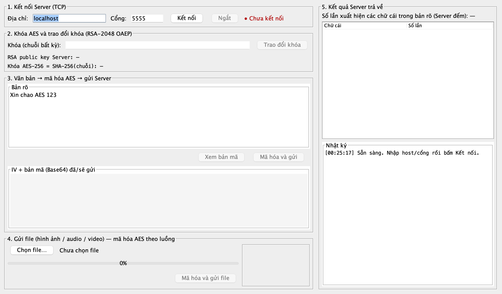

**Hình 2.2 — Đã kết nối.** Trạng thái xanh; nhật ký ghi `← HELLO` với fingerprint RSA
`02:74:A9:FE:A0:B0:11:9B` — trùng dòng đầu console Server bên dưới. Ô khóa và nút Trao đổi khóa mở.

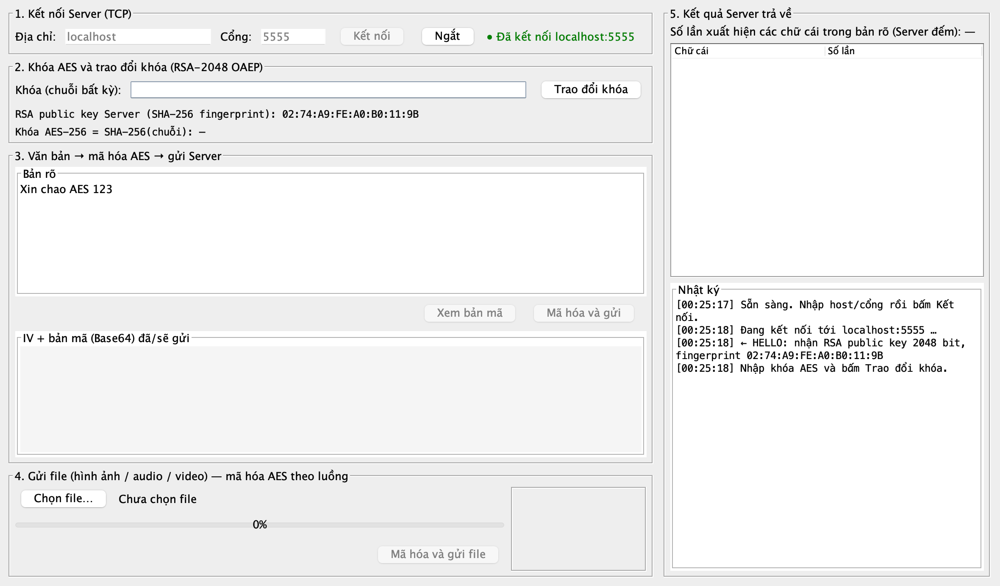

**Hình 2.3 — Trao đổi khóa.** Nhập `khoa bi mat 2026` → Client hiện khóa AES-256 dẫn xuất
`054a3b244b66d77c…`, nhật ký `→ KEY_EXCHANGE … đã bọc RSA-OAEP (256 byte)` và `← KEY_OK`. Nút gửi
văn bản mở.

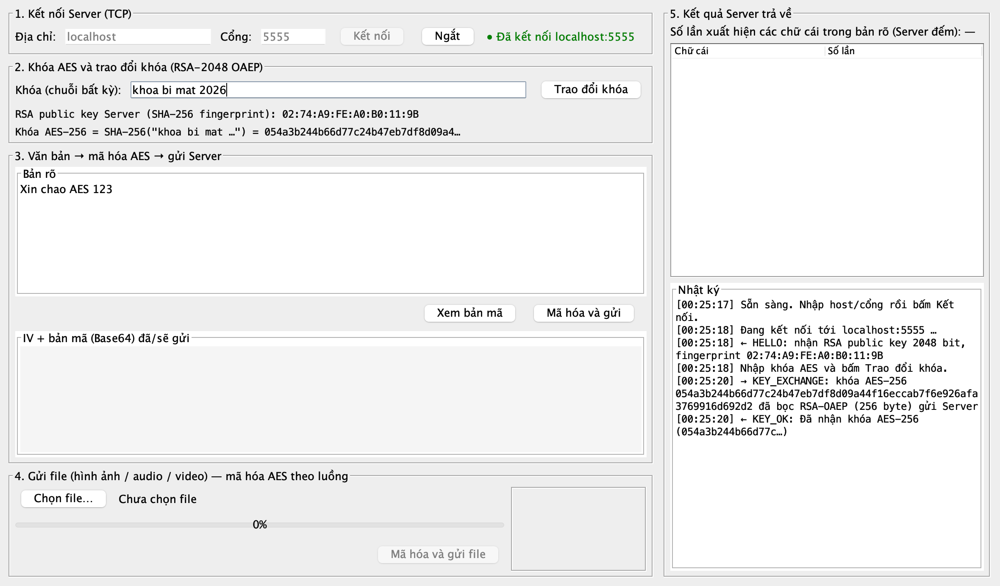

**Hình 2.4 — Xem bản mã trước khi gửi.** IV 16 byte hex và bản mã 32 byte Base64 của
`Xin chao AES 123`.

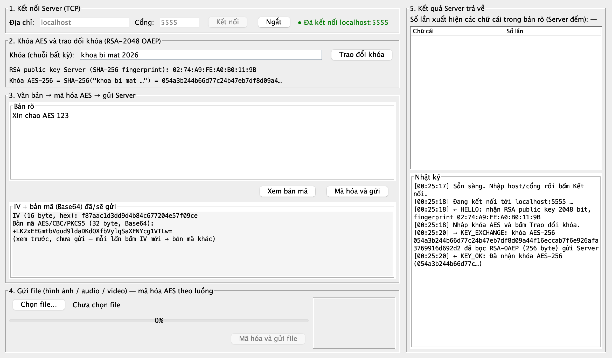

**Hình 2.5 — Kết quả đếm chữ cái.** Server giải mã đúng bản rõ, trả `a=2;c=1;e=1;h=1;i=1;n=1;o=1;s=1;x=1`
(9 chữ cái khác nhau, tổng 10 lần — chữ số `123` và dấu cách không tính). Bảng bên phải sắp giảm dần.

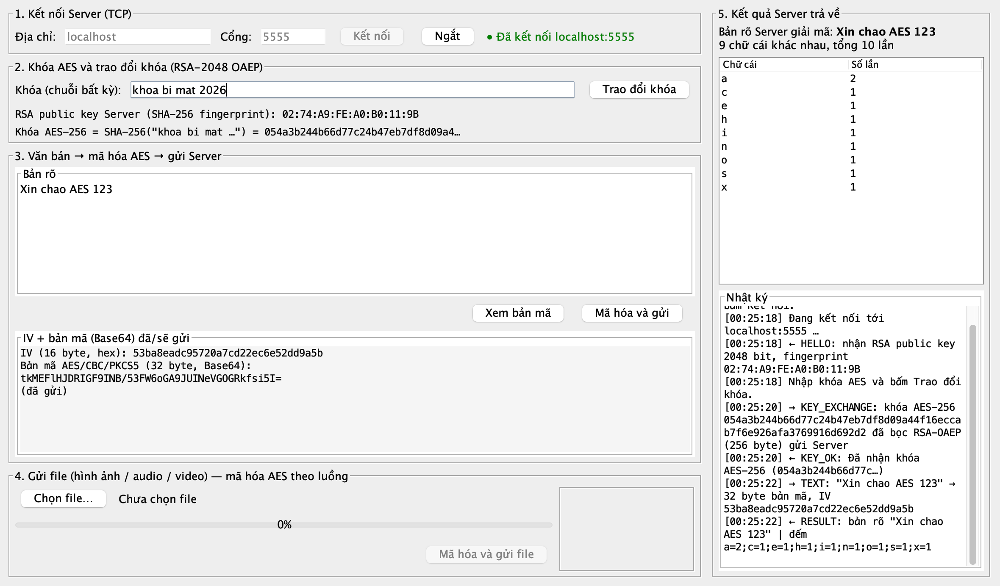

**Hình 2.5b — Gửi lại cùng bản rõ.** IV mới → bản mã Base64 **khác** hình 2.5, kết quả đếm giống.

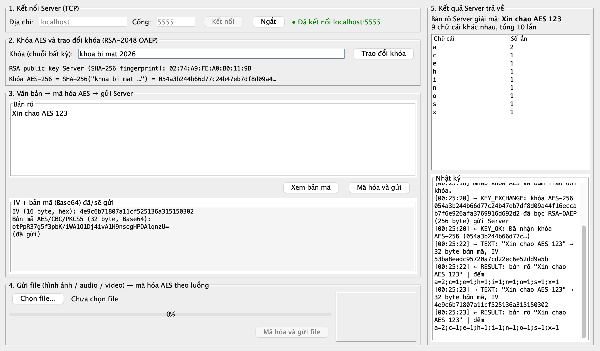

**Hình 2.6 — Văn bản tiếng Việt.** `Lập trình mạng — Đề tài 8: Chat và gửi file mã hóa AES` → 24 chữ
cái khác nhau, 38 lần; chữ có dấu (`à`, `ậ`, `ề`…) được đếm riêng, UTF-8 đi qua AES nguyên vẹn.

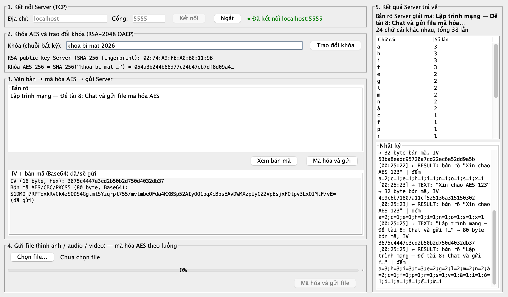

**Hình 2.7 — Chọn file ảnh.** Thumbnail, kích thước gốc 42 900 byte và bản mã 42 912 byte tính trước.

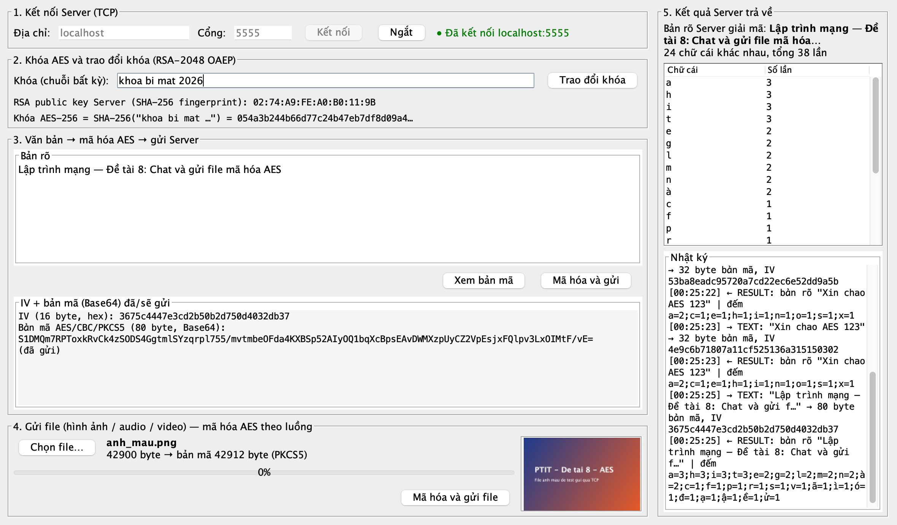

**Hình 2.8 — Gửi ảnh xong.** `← FILE_OK` kèm đường dẫn Server lưu và SHA-256
`451115e6…f96ac`.

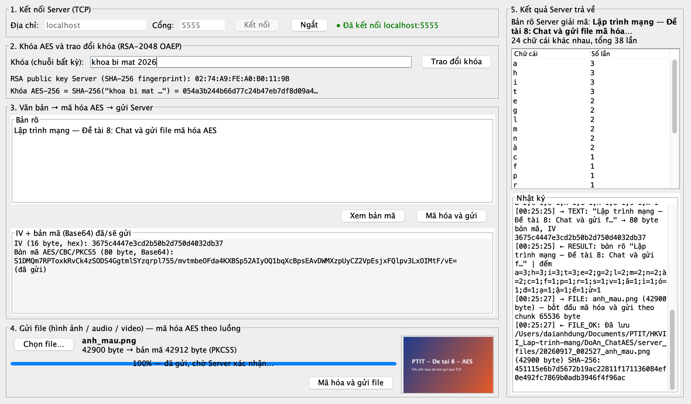

**Hình 2.9 — Gửi file 60 MB.** 60 000 000 byte → bản mã 60 000 016 byte; progress 100 %, Server xác
nhận SHA-256.

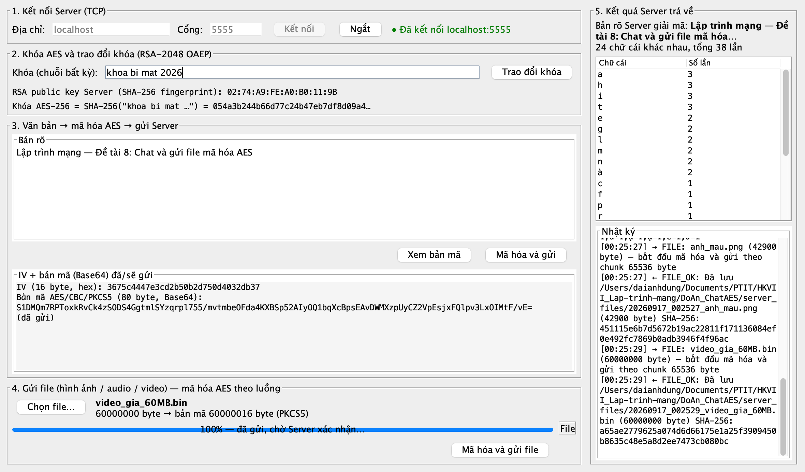

**Console Server** trong cùng phiên chạy kịch bản tự động (mục 2.6) — cho thấy Server nhận được
**bản mã** (hex) và chỉ sau khi giải mã bằng khóa đã mở từ RSA mới có bản rõ:

```
[00:23:49] Server lắng nghe cổng 5555 | RSA fingerprint 02:74:A9:FE:A0:B0:11:9B
[00:23:50] C1 kết nối từ /127.0.0.1:51338
[00:23:50] C1 KEY_EXCHANGE: khóa AES đã mở = 314e2b64ae5733e88c11fe82a13893f54687e3525dbd7fd7b629d373e9a83b11
[00:23:50] C1 TEXT  iv=b0b0caa41060fb6f415b4a3b6206b496
[00:23:50] C1       bản mã (32 byte) = 0fdae3195f710aede7a2643156126364e8dec017604f97287bfd741406e7dac8
[00:23:50] C1       bản rõ = "Xin chao AES 123"
[00:23:50] C1       đếm    = a=2;c=1;e=1;h=1;i=1;n=1;o=1;s=1;x=1
[00:23:50] C1 TEXT  iv=a8747121471560dfb55e9a0b97e67a63
[00:23:50] C1       bản mã (32 byte) = e75c6396b369136ac1d5fa22d8314cc9cc1c65d816865e262e4a6e012832eda0
[00:23:50] C1       bản rõ = "Xin chao AES 123"
[00:23:50] C1 FILE  anh_mau.png gốc=42900 byte, bản mã=42912 byte
[00:23:50] C1       đã lưu server_files/20260917_002350_anh_mau.png sha256=451115e6b7d5672b19ac22811f171136084ef0e492fc7869b0adb3946f4f96ac
[00:23:50] C1 FILE  audio_mau.wav gốc=264644 byte, bản mã=264656 byte
[00:23:50] C1       đã lưu server_files/20260917_002350_audio_mau.wav sha256=33a6f710657b2048480952e2464f547eac8c65bf990a64250dc6e785901b38c0
[00:23:50] C1 KEY_EXCHANGE: khóa AES đã mở = 6795a60e67e942fd3e282e4c59613c80b0f85935bc0a42fb4d4f4d32d8b6d457
[00:23:50] C1 gửi BYE
```

Hai dòng `TEXT` đầu: cùng bản rõ, IV khác → bản mã khác hoàn toàn. Dòng `KEY_EXCHANGE` thứ hai là
đổi khóa giữa phiên.

**Đối chiếu SHA-256** file gốc và file Server lưu:

```
$ shasum -a 256 data/mau/* server_files/*
451115e6…f4f96ac  data/mau/anh_mau.png
33a6f710…901b38c0  data/mau/audio_mau.wav
451115e6…f4f96ac  server_files/20260917_002350_anh_mau.png
33a6f710…901b38c0  server_files/20260917_002350_audio_mau.wav
```

Trùng từng byte: dữ liệu đi qua mạng ở dạng mã, Server giải mã ra đúng file gốc.

---

## 2.6 Kiểm thử

| Lớp kiểm thử | Cách chạy | Kết quả |
|---|---|---|
| Đơn vị `common` — 28 phép kiểm: dẫn xuất khóa, roundtrip chuỗi/luồng, `kichThuocBanMa` cho 8 biên (0…1 MB), sai khóa ném lỗi, RSA bọc/mở, không lộ khóa thô, đếm chữ cái, parse | `java -cp build/classes common.CommonSelfTest` | `TẤT CẢ OK` |
| E2E không GUI — `ClientConnection` thật ↔ `MockServer` thật: kết nối, chặn gửi khi chưa khóa, `TEXT`, gửi lại cùng bản rõ ra bản mã khác, tiếng Việt, gửi PNG + WAV, đổi khóa giữa phiên, 5 gói liên tiếp về đúng thứ tự, ngắt socket | kịch bản `E2E.java` | `E2E OK`, SHA-256 khớp |
| E2E lỗi — kill Server giữa phiên | kịch bản `E2E2.java` | `onNgat("Server đã đóng kết nối")`, `dangKetNoi = false`, kết nối lại bị `Connection refused` đúng |
| GUI — 9 bước thao tác, chụp ảnh tự động (mục 2.5) | harness reflection trên `ClientFrame` | 9 ảnh, mọi nhãn/bảng/nhật ký đúng |
| Build | `ant clean jar` (NetBeans) và `javac -Xlint:all` | `BUILD SUCCESSFUL`, 0 lỗi |

---

## Phụ lục — Câu hỏi vấn đáp dự kiến

**Vì sao chọn AES-256 mà không phải AES-128?** SHA-256 cho ra đúng 32 byte nên AES-256 là lựa chọn tự
nhiên; AES-128 vẫn an toàn thực tế, đổi sang chỉ cần cắt 16 byte đầu của digest. Chi phí AES-256 cao
hơn ~40 % nhưng với văn bản và file vài trăm MB vẫn hàng trăm MB/s.

**AES khác DES chỗ nào?** DES khối 64 bit, khóa 56 bit — đã bị phá vét cạn từ 1998. AES khối 128 bit,
khóa 128/192/256 bit, cấu trúc SPN (thay thế–hoán vị) thay cho Feistel, nhanh hơn trên phần cứng
hiện đại (AES-NI).

**Vì sao CBC cần IV? Không có thì sao?** Không IV (hoặc IV cố định) thì cùng bản rõ → cùng bản mã;
kẻ nghe lén phát hiện tin nhắn lặp. IV ngẫu nhiên mỗi lần làm bản mã khác nhau dù nội dung giống.
IV gửi công khai kèm bản mã — không cần giữ bí mật.

**IV gửi công khai có nguy hiểm không?** Không. Bảo mật CBC dựa vào khóa; IV chỉ cần **không dự đoán
được trước** và không lặp với cùng khóa.

**Vì sao không dùng GCM?** GCM cho thêm xác thực (chống sửa bản mã). Đề chỉ yêu cầu mã hóa/giải mã
nên chọn CBC vì dễ giải thích quá trình đệm và tính kích thước bản mã trước; toàn vẹn file được đối
chiếu bằng SHA-256 trong `FILE_OK`. Nâng cấp lên GCM chỉ đổi transformation và thêm 16 byte tag.

**"Trao đổi khóa với Server" được làm thế nào? Sao không gửi thẳng khóa?** Gửi thẳng thì ai bắt gói
đọc được khóa và giải mã cả phiên. Client bọc khóa AES bằng RSA public key của Server (RSA-OAEP);
chỉ Server có private key mới mở. Đây là hybrid encryption như TLS.

**Vì sao không mã hóa mọi thứ bằng RSA?** RSA chậm hơn AES hàng nghìn lần và mỗi lần chỉ mã hóa được
tối đa 190 byte với khóa 2048/OAEP-SHA256. RSA chỉ dùng cho 32 byte khóa; dữ liệu dùng AES.

**Điểm yếu còn lại?** Client không xác thực public key của Server (không chứng chỉ) nên kẻ đứng giữa
có thể giả Server. Giao diện hiện fingerprint để đối chiếu thủ công; giải pháp đầy đủ là TLS/chứng chỉ.

**TCP đảm bảo gì cho việc gửi file lớn?** Tin cậy (mất gói thì phát lại), đúng thứ tự, kiểm soát
luồng. Nhưng TCP **không** có ranh giới gói, nên giao thức phải tự khai độ dài — vì thế header `FILE`
có `kichThuocBanMa`.

**Tính `kichThuocBanMa` thế nào? Vì sao `+1`?** PKCS5 luôn đệm ít nhất 1 byte, kể cả khi bản rõ chia
hết cho 16 (để bên giải mã luôn biết bỏ bao nhiêu byte). Do đó `(n/16 + 1)*16`: 16 → 32, 15 → 16.

**Sao không dùng `CipherInputStream` phía Server?** Nó đọc tới EOF, sẽ nuốt luôn gói kế tiếp trên
cùng socket. Ta đọc đúng `kichThuocBanMa` byte bằng `Cipher.update` rồi dừng.

**Vì sao gửi file trong SwingWorker còn gửi văn bản thì không?** Văn bản vài KB ghi vào buffer socket
tức thời. File hàng trăm MB mất nhiều giây; đặt trên EDT giao diện sẽ đứng hình và progress bar không
vẽ được.

**Hai thread cùng ghi một socket có sao không?** Có — header `FILE` và thân file có thể bị gói `TEXT`
chen vào. `ClientConnection` khóa `synchronized(out)` quanh trọn một gói.

**Server chưa chạy thì Client làm gì?** `connect()` với timeout 5 s → `ConnectException`/`SocketTimeout`
→ dialog "Không kết nối được … nhập lại địa chỉ/cổng", ô nhập mở lại.

**Nếu bạn Server đổi CSDL / ngôn ngữ thì Client có phải sửa không?** Không. Client chỉ phụ thuộc định
dạng gói trong `DoAn_PROTOCOL.md`; kết quả đếm là chuỗi phẳng `a=2;b=1`, không phải object Java.
