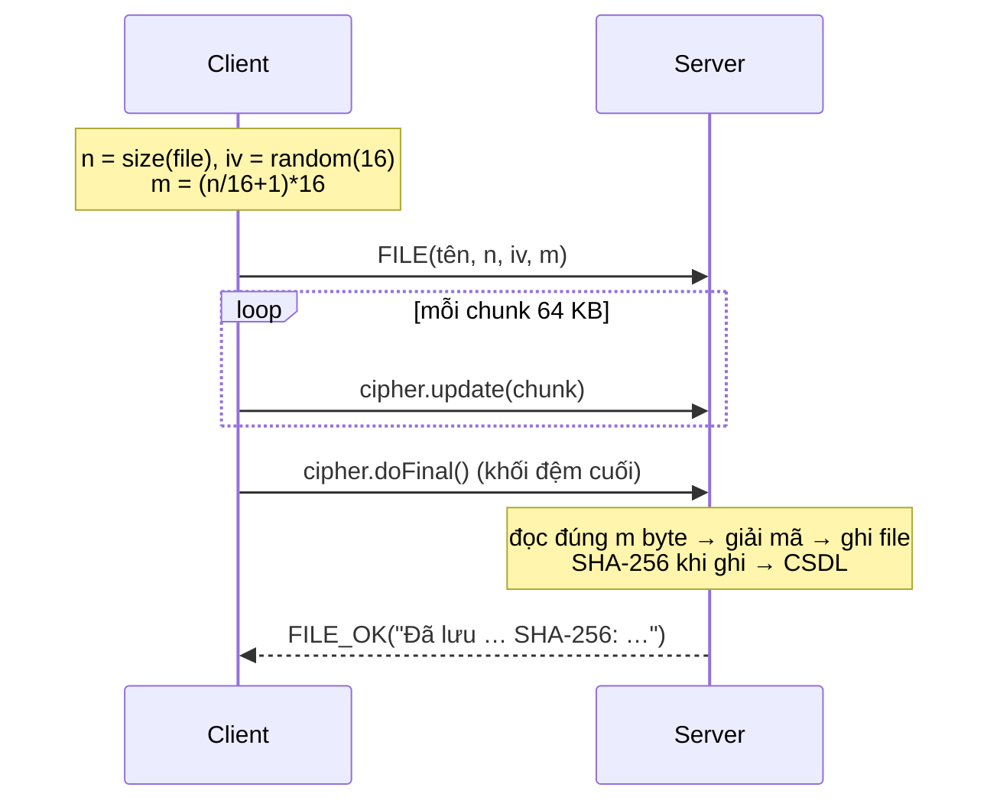

> **Tài liệu v1 / legacy.** Bản multi-user hiện tại dùng [PROTOCOL.md](PROTOCOL.md); Server mới là `chat.server.ServerMain`.

# Đề tài 8 — Đặc tả giao thức Client ↔ Server

> Tài liệu cho **cả nhóm**. Client (package `client`) đã hiện thực đúng theo đây và đã test
> với `server.MockServer`. Bạn làm Server chỉ cần giữ nguyên định dạng gói và dùng lại
> package `common` — mọi thứ về byte, AES, RSA, đếm chữ cái đều nằm sẵn trong đó.
>
> Code: `../src/` · Server tham chiếu: `server/MockServer.java` (không CSDL)

---

## 1. Tổng quan

```
   Client (Swing)                                   Server
┌────────────────────┐        TCP          ┌──────────────────────────┐
│ nhập khóa → SHA-256│  ◄── HELLO ───────  │ sinh RSA-2048 khi start  │
│ = khóa AES-256     │  ── KEY_EXCHANGE ►  │ mở khóa AES bằng private │
│ mã hóa AES/CBC     │  ◄── KEY_OK ──────  │                          │
│ văn bản, file      │  ── TEXT ─────────► │ giải mã → đếm chữ cái    │
│                    │  ◄── RESULT ──────  │ → lưu CSDL               │
│                    │  ── FILE ─────────► │ giải mã stream → lưu file│
│                    │  ◄── FILE_OK ─────  │ → lưu CSDL               │
└────────────────────┘                     └──────────────────────────┘
```

- Một kết nối TCP = một **phiên**. Khóa AES là trạng thái của phiên (Server phải giữ theo từng
  socket, không dùng biến static — hai Client có thể dùng hai khóa khác nhau cùng lúc).
- Server gửi `HELLO` **ngay khi accept**, trước khi Client gửi bất cứ gì.
- Client chỉ được gửi `TEXT`/`FILE` sau khi đã `KEY_EXCHANGE`. Server nhận `TEXT`/`FILE` khi chưa có
  khóa thì trả `ERROR` (và với `FILE` phải đọc bỏ hết thân file để luồng không lệch).

## 2. Định dạng gói

Mọi gói = **1 byte loại** + payload. Ghi/đọc bằng `DataOutputStream` / `DataInputStream`
(big-endian, mặc định của Java). Hai kiểu payload:

| Kiểu | Ghi | Đọc |
|---|---|---|
| Chuỗi | `writeUTF(s)` (JDK tự thêm 2 byte độ dài, UTF-8 sửa đổi) | `readUTF()` |
| Mảng byte | `writeInt(len)` rồi `write(bytes)` — `PacketIO.ghiBytes` | `readInt()` rồi `readFully` — `PacketIO.docBytes` (từ chối > 16 MB) |

TCP là luồng byte không có ranh giới gói, nên **độ dài luôn đi trước dữ liệu** — bên nhận biết chính
xác phải đọc bao nhiêu byte, không cần ký tự kết thúc, không bị dính hai gói vào nhau.

### 2.1 Bảng gói

| Hướng | Loại | Hex | Payload (theo thứ tự) |
|---|---|---|---|
| S → C | `HELLO` | `0x10` | `bytes` RSA public key, định dạng X.509 SubjectPublicKeyInfo (`PublicKey.getEncoded()`), 2048 bit |
| C → S | `KEY_EXCHANGE` | `0x11` | `bytes` 32 byte khóa AES đã bọc bằng `RSA/ECB/OAEPWithSHA-256AndMGF1Padding` → luôn **256 byte** |
| S → C | `KEY_OK` | `0x12` | `UTF` thông báo (tùy ý, Client chỉ hiển thị) |
| C → S | `TEXT` | `0x01` | `bytes` IV (16 byte) · `bytes` bản mã `AES/CBC/PKCS5Padding` của UTF-8(bản rõ) |
| S → C | `RESULT` | `0x81` | `UTF` bản rõ đã giải mã · `UTF` kết quả đếm `"a=3;b=1;..."` |
| C → S | `FILE` | `0x02` | `UTF` tên file · `long` kích thước gốc · `bytes` IV (16) · `long` kích thước bản mã · **rồi đúng bấy nhiêu byte bản mã** (không có int độ dài nữa) |
| S → C | `FILE_OK` | `0x82` | `UTF` thông báo — nên kèm đường dẫn lưu, kích thước và **SHA-256 của bản rõ** để Client đối chiếu |
| C → S | `BYE` | `0x03` | — |
| S → C | `ERROR` | `0xFF` | `UTF` mô tả lỗi. Phiên **vẫn tiếp tục** (Client chỉ hiện dialog) |

Hằng số: `common.Protocol`. Hàm gửi/nhận từng gói: `common.PacketIO`.

### 2.2 Vì sao `FILE` không dùng `bytes` như `TEXT`

`PacketIO.docBytes` đọc cả mảng vào RAM — với video vài trăm MB là không được. Thân file vì thế đi
dạng **luồng thô**: header khai báo trước `kichThuocBanMa`, hai bên đọc/ghi theo chunk 64 KB
(`AESUtil.maHoaLuong` / `giaiMaLuong`). Kích thước bản mã tính được trước khi mã hóa nhờ PKCS5:

```
kichThuocBanMa = (kichThuocGoc / 16 + 1) * 16        // AESUtil.kichThuocBanMa
```

PKCS5 **luôn** thêm ít nhất 1 byte đệm, kể cả khi bản rõ đã chia hết cho 16 — nên `+ 1` là đúng
cho mọi trường hợp (0 → 16, 15 → 16, 16 → 32, 17 → 32). `PacketIO.docFileHeader` kiểm tra lại đẳng
thức này và ném lỗi nếu header không khớp.

Server **không dùng `CipherInputStream`** để đọc thân file: lớp đó đọc tới EOF, sẽ nuốt luôn gói
sau. `AESUtil.giaiMaLuong` đọc đúng `kichThuocBanMa` byte rồi dừng, socket dùng tiếp được.

## 3. Mật mã

| Thành phần | Chọn | Lý do |
|---|---|---|
| Thuật toán | `AES/CBC/PKCS5Padding`, khóa 256 bit | Đề yêu cầu AES. CBC + IV ngẫu nhiên để cùng bản rõ ra bản mã khác nhau. 256 bit vì SHA-256 cho ra đúng 32 byte |
| Dẫn xuất khóa | `SHA-256(UTF-8(chuỗi người dùng nhập))` | AES chỉ nhận 16/24/32 byte; băm để người dùng gõ chuỗi bất kỳ, hai bên tính ra cùng khóa |
| IV | 16 byte `SecureRandom`, **mới cho mỗi gói**, gửi kèm | IV không bí mật, chỉ cần không lặp |
| Trao đổi khóa | RSA-2048, padding OAEP (SHA-256 + MGF1) | Khóa AES không đi qua mạng dạng thô; chỉ Server có private key mới mở được. OAEP thay PKCS#1 v1.5 vì v1.5 đã có tấn công lựa chọn bản mã (Bleichenbacher) |

Server sinh cặp RSA **một lần khi khởi động** (tốn ~100 ms), dùng chung cho mọi phiên; khóa AES
thì **riêng từng phiên**.

Client có thể gửi `KEY_EXCHANGE` **lại** giữa phiên để đổi khóa; Server thay khóa của phiên đó và trả
`KEY_OK`.

## 4. Kết quả đếm chữ cái — `common.LetterFrequency`

- "Chữ cái" = `Character.isLetter(c)`. Chữ số, dấu cách, dấu câu **bỏ qua**. Chữ Việt có dấu là
  chữ cái riêng (`à` ≠ `a`).
- Gộp hoa/thường về **thường**: `"Xin Chao"` → `x=1;i=1;n=1;c=1;h=1;a=1;o=1`.
- Định dạng dây: `ký_tự=số;ký_tự=số;...`, **sắp giảm dần theo số lần**, bằng nhau thì theo thứ tự
  ký tự. Ví dụ `"Xin chao AES 123"` → `a=2;c=1;e=1;h=1;i=1;n=1;o=1;s=1;x=1`.
- Server gọi `LetterFrequency.dem(banRo)`; Client gọi `parse(chuoi)` để đổ bảng. Dùng chuỗi phẳng thay
  Java serialization để Server viết bằng gì cũng đọc được.

## 5. Trình tự

### 5.1 Handshake + văn bản

```mermaid
sequenceDiagram
    participant C as Client
    participant S as Server
    C->>S: TCP connect
    S-->>C: HELLO(rsaPublicKey)
    Note over C: k = SHA-256(khóa gõ vào)
    C->>S: KEY_EXCHANGE(RSA-OAEP(k))
    Note over S: k = RSA-decrypt(private)
    S-->>C: KEY_OK("Đã nhận khóa…")
    Note over C: iv = random(16)<br/>ct = AES-CBC(k, iv, utf8(bản rõ))
    C->>S: TEXT(iv, ct)
    Note over S: bản rõ = AES-decrypt(k, iv, ct)<br/>đếm chữ cái → CSDL
    S-->>C: RESULT(bản rõ, "a=2;c=1;…")
```

### 5.2 File



### 5.3 Kết thúc và lỗi

| Tình huống | Hành vi |
|---|---|
| Client bấm Ngắt / đóng cửa sổ | đóng socket ngay để hủy I/O đang chờ; Server thấy EOF → đóng phiên (`BYE` vẫn được hỗ trợ) |
| Server tắt giữa phiên | Client đọc được EOF → báo "Server đã đóng kết nối", reset trạng thái về chưa kết nối |
| Sai khóa (Server giải mã lỗi padding) | `ERROR("Giải mã thất bại (sai khóa?)")`, phiên tiếp tục. Với `FILE`, thân đã đọc hết trước khi `doFinal` ném lỗi nên luồng vẫn thẳng hàng |
| Gói loại lạ | `ERROR` rồi Server đóng phiên (không biết payload dài bao nhiêu để bỏ qua) |

## 6. Gợi ý CSDL cho Server (bắt buộc theo đề; chưa triển khai trong MockServer v1)

MockServer đánh dấu `// TODO CSDL` tại hai chỗ cần INSERT. Schema đề xuất (MySQL/SQL Server đều được):

```sql
CREATE TABLE tin_nhan (
    id          INT PRIMARY KEY AUTO_INCREMENT,
    thoi_gian   DATETIME      NOT NULL,
    dia_chi     VARCHAR(64),             -- ip:port của Client
    iv_hex      CHAR(32)      NOT NULL,
    ban_ma_hex  TEXT          NOT NULL,   -- lưu bản mã để chứng minh dữ liệu trên đường truyền là mã
    ban_ro      TEXT          NOT NULL,
    ket_qua_dem TEXT          NOT NULL    -- "a=2;c=1;..."
);

CREATE TABLE tap_tin (
    id          INT PRIMARY KEY AUTO_INCREMENT,
    thoi_gian   DATETIME      NOT NULL,
    dia_chi     VARCHAR(64),
    ten_file    VARCHAR(255)  NOT NULL,
    kich_thuoc  BIGINT        NOT NULL,
    sha256      CHAR(64)      NOT NULL,
    duong_dan   VARCHAR(500)  NOT NULL    -- nơi Server lưu bản rõ
);
```

Khóa AES **không** nên lưu vào CSDL (bản mã lưu cùng khóa thì mã hóa vô nghĩa). Nếu đề/giảng viên
yêu cầu lưu khóa, lưu ở bảng riêng và ghi rõ trong báo cáo đó là để phục vụ demo.

## 7. Chạy thử

```bash
cd DoAn_ChatAES
javac -encoding UTF-8 -d build/classes $(find src -name '*.java')
java -cp build/classes common.CommonSelfTest        # tự kiểm tra AES/RSA/đếm — phải in TẤT CẢ OK
java -cp build/classes server.MockServer            # cửa sổ 1, cổng 5555
java -cp build/classes client.ClientMain            # cửa sổ 2
```

Hoặc NetBeans: `File → Open Project → DoAn_ChatAES`, right-click `MockServer.java` → Run File, rồi
Run Project (main class = `client.ClientMain`).

File mẫu để demo: `data/mau/anh_mau.png`, `audio_mau.wav`, `video_mau.mp4`. Đối chiếu sau khi gửi:

```bash
shasum -a 256 data/mau/anh_mau.png server_files/*_anh_mau.png   # hai dòng phải giống nhau
```
